# Customer Churn Prediction & Analytics

Predicts which telecom customers are likely to cancel their service, explains which factors are
associated with churn, and serves the model in a Streamlit app with a LOW / MEDIUM / HIGH risk label.

Built with **pandas, scikit-learn Pipelines, joblib and Streamlit** on the public
**IBM Telco Customer Churn** dataset. Every number in this README comes from running
`python -m src.train` (outputs in [`reports/`](reports/)).

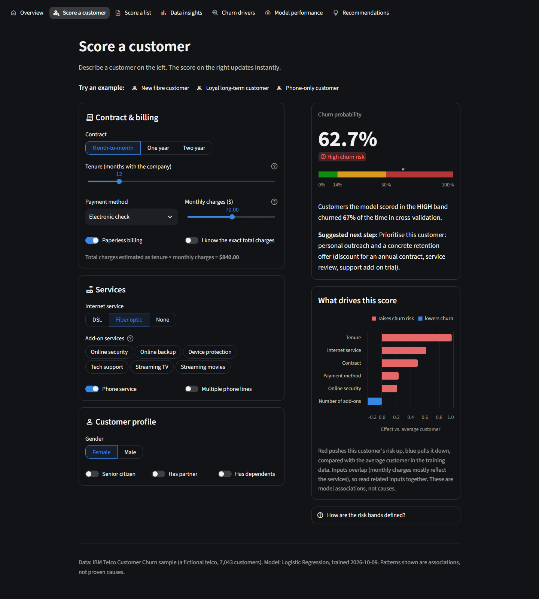

---

## Contents
[Business problem](#business-problem) · [Dataset](#dataset) · [EDA](#exploratory-data-analysis) ·
[Preprocessing & features](#preprocessing--feature-engineering) · [Models](#models--evaluation) ·
[Results](#results) · [Final model](#final-model--threshold) · [Explainability](#what-is-associated-with-churn) ·
[Architecture](#architecture) · [App](#streamlit-app) · [How to run](#how-to-run) ·
[Example prediction](#example-prediction) · [Business insights](#business-insights) ·
[Limitations](#limitations) · [Future work](#future-improvements)

## Business problem

Keeping an existing customer is usually cheaper than acquiring a new one. A retention team wants to know:

1. **Who is at risk?** A churn probability per customer, so offers can be targeted.
2. **Why?** Which customer characteristics go together with churn.
3. **Which model?** One chosen with a stated criterion, not just the highest accuracy.
4. **How to act?** A threshold and risk bands the team can turn into a contact list.

A missed churner (false negative) costs the whole customer. A false alarm (false positive) costs
one retention offer. The model is therefore tuned to favour **recall**.

## Dataset

| | |
|---|---|
| Source | [IBM/telco-customer-churn-on-icp4d](https://github.com/IBM/telco-customer-churn-on-icp4d), Apache-2.0 (archived) |
| Rows / columns | 7,043 customers × 21 columns (19 features, an ID and the target) |
| Target | `Churn` = Yes for 1,869 customers (**26.5%**) |
| Nature | IBM's sample data for a **fictional** telco: one snapshot, no timestamps |

The CSV is not committed. `python -m src.data_loader` downloads it and verifies a SHA-256 checksum.
See [`data/README.md`](data/README.md) for manual placement.

## Exploratory data analysis

Full notebook, executed with real outputs: [`notebooks/churn_analysis.ipynb`](notebooks/churn_analysis.ipynb).

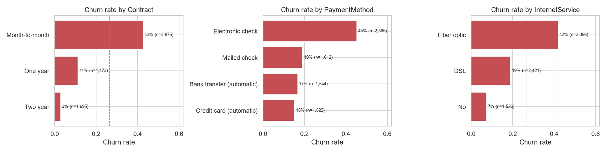

| Finding (whole dataset) | Numbers |
|---|---|
| Month-to-month contracts churn most | 42.7% vs 11.3% (one-year) and 2.8% (two-year) |
| New customers churn most | 47.4% in the first 12 months vs 9.5% after 48 months. Median tenure 10 months (churned) vs 38 (stayed) |
| Fibre optic churns more than DSL | 41.9% vs 19.0%. The gap holds within every contract type |
| Electronic check payers churn most | 45.3% vs 15.2–19.1% for the other methods |
| More add-ons, less churn (internet customers) | 52.2% with 0 add-ons, falling to 5.3% with all 6 |
| Gender makes no difference | 26.9% (female) vs 26.2% (male) |

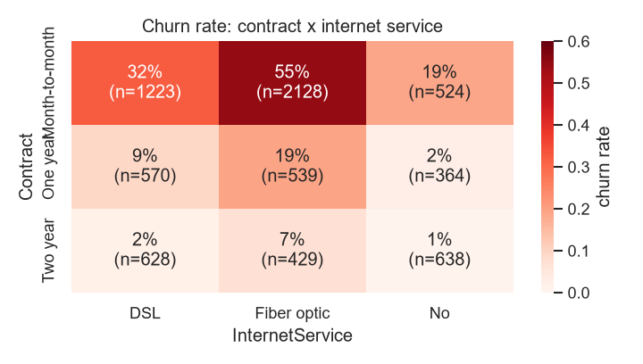

## Preprocessing & feature engineering

Data quality issues found and how they were handled ([`src/preprocessing.py`](src/preprocessing.py)).
Every step is logged in `reports/metrics.json → cleaning_report`, and **no rows are dropped**.

| Issue | Decision |
|---|---|
| `TotalCharges` stored as text, 11 blanks | All 11 have `tenure = 0` (not yet billed), so set to **0.0**. Training fails loudly if a blank ever appears with tenure > 0 |
| `SeniorCitizen` is 0/1, other binaries Yes/No | Mapped to No/Yes for consistency |
| 22 rows identical except `customerID` | **Kept**: distinct IDs, so separate customers with the same profile |
| `customerID` | Dropped (identifier) |
| "No internet service" / "No phone service" values | Kept as their own category |

**Leakage control:** everything learned (imputers, scaler, encoder, model) lives in one
scikit-learn `Pipeline` fit on the training split only. The decision threshold is tuned on
out-of-fold training predictions, and the test set is used once, for the final report.

```
Pipeline
├── features    FunctionTransformer(add_features)        # row-wise, nothing learned
├── preprocess  ColumnTransformer
│   ├── numeric      SimpleImputer(median) → StandardScaler
│   └── categorical  SimpleImputer(most_frequent) → OneHotEncoder(handle_unknown="ignore")
└── model       LogisticRegression(C=1.0)
```

**Engineered features** ([`src/features.py`](src/features.py)): `num_addon_services`,
`avg_monthly_spend` (TotalCharges / tenure) and `tenure_bucket`. An ablation with 5-fold CV showed they
make **no measurable difference** (mean ROC-AUC change +0.0001 across the three models). The
pre-registered rule was to keep them unless they hurt by more than 0.001, so they stay. They are not
a source of performance.

The imputers are there for prediction time: the app and `src.predict` accept records with missing
fields. The training data itself has no missing values after cleaning.

## Models & evaluation

* Stratified **80/20 split** (`random_state=42`): 5,634 train / 1,409 test, both at 26.5% churn.
* **5-fold stratified CV** on the training split, with a small `GridSearchCV` per model scored on ROC-AUC:
  * Logistic Regression: `C ∈ {0.01, 0.1, 1, 10}`, best C = 1.0
  * Random Forest (300 trees): `max_depth ∈ {None, 8, 12}`, `min_samples_leaf ∈ {1, 5, 10}`, best depth 8 / leaf 10
  * HistGradientBoosting: `learning_rate ∈ {0.03, 0.1}`, `max_depth ∈ {3, 6}`, `max_iter ∈ {100, 300}`, best 0.03 / 3 / 100
* A `DummyClassifier` baseline is included for reference.
* `class_weight="balanced"` was deliberately **not** used. It would distort the predicted
  probabilities that the app displays. Class imbalance is handled with the decision threshold instead.

## Results

Test set (1,409 customers, never used for any choice). Metrics at threshold 0.50 unless noted.
Source: [`reports/model_comparison.md`](reports/model_comparison.md).

| Model | CV ROC-AUC (mean ± std) | Accuracy | Precision | Recall | F1 | ROC-AUC |
|---|---|---|---|---|---|---|
| Dummy (prior) | 0.500 ± 0.000 | 0.735 | 0.000 | 0.000 | 0.000 | 0.500 |
| Logistic Regression | 0.846 ± 0.012 | 0.799 | 0.653 | 0.519 | 0.578 | 0.842 |
| Random Forest | 0.848 ± 0.010 | 0.803 | 0.675 | 0.495 | 0.571 | 0.844 |
| HistGradientBoosting | 0.848 ± 0.011 | 0.806 | 0.695 | 0.481 | 0.569 | 0.845 |
| **Logistic Regression @ 0.14 (final)** | | 0.663 | 0.436 | **0.925** | **0.593** | 0.842 |

The three models are statistically indistinguishable on this data. Their CV ROC-AUCs differ by
0.002, well inside one standard deviation (~0.01). The dummy model's 73.5% accuracy shows why
accuracy alone is misleading here.

<p>
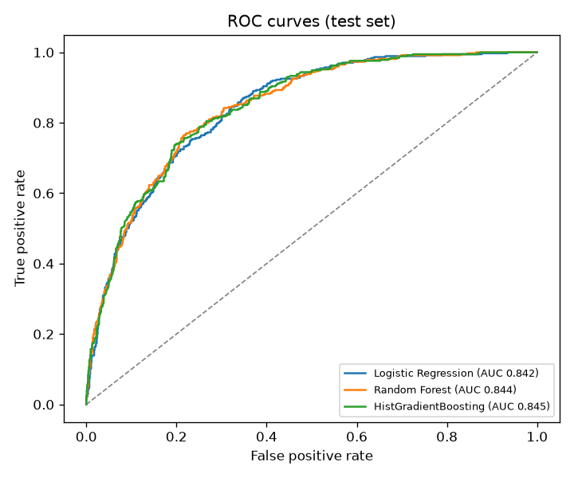
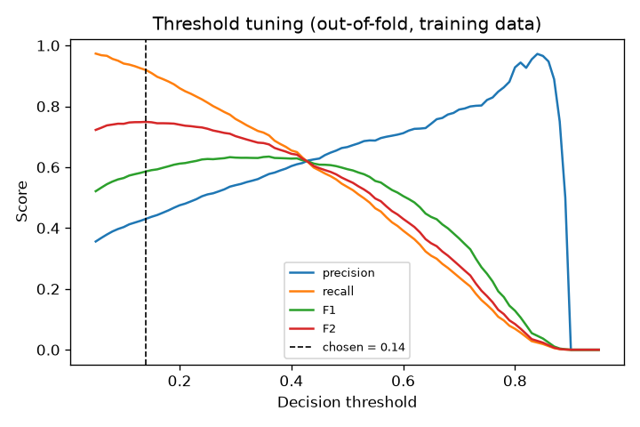
</p>

## Final model & threshold

**Selection rule (fixed before seeing results):** rank by mean CV ROC-AUC. If several models are
within 0.005 of the best, pick the most interpretable one. All three were within 0.005, so
**Logistic Regression** was chosen. It performs as well as the tree ensembles, its coefficients can be
read directly, and it gives exact per-customer explanations in the app.

**Threshold:** the cut-off that maximises **F2** (recall weighted 2× over precision) on out-of-fold
training predictions is **0.14**. The F2 curve is flat between 0.10 and 0.20 (0.740–0.749), so the
exact value is not fragile. On the test set:

| | Threshold 0.50 | Threshold 0.14 |
|---|---|---|
| Churners caught (recall) | 194 / 374 (51.9%) | **346 / 374 (92.5%)** |
| Missed churners (FN) | 180 | **28** |
| False alarms (FP) | 103 | 447 |
| Customers flagged | 297 (21.1%) | 793 (56.3%) |

The trade-off is explicit: the tuned threshold flags more than half of all customers to miss very
few churners. That only makes sense when the retention offer is cheap. A team with a small budget
should work down the list by probability (HIGH first) instead of contacting everyone flagged.

**Risk bands.** The probabilities are well calibrated: test Brier score 0.137, and out-of-fold
predicted vs observed churn rates match closely (`reports/figures/calibration.png`). The bands are:

| Band | Rule | Test share | Observed churn in band (test) |
|---|---|---|---|
| LOW | p < 0.14 (not flagged) | 43.7% | 4.5% |
| MEDIUM | 0.14 ≤ p < 0.50 (flagged) | 35.2% | 30.6% |
| HIGH | p ≥ 0.50 (churn more likely than not) | 21.1% | 65.3% |

## What is associated with churn?

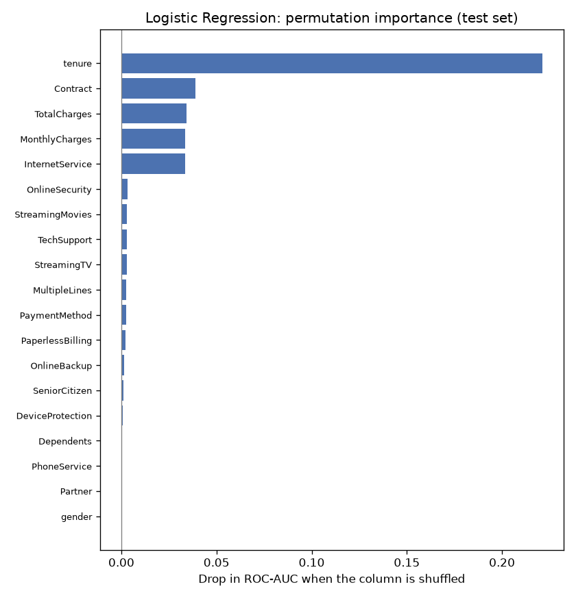

* **Permutation importance** (final model, test set): **tenure** dominates. Shuffling it drops ROC-AUC
  by 0.22. Next come contract (0.039), total charges (0.034), monthly charges (0.034) and internet
  service (0.034). Every other input is below 0.004, and gender, partner and phone service are ~0.
* **Logistic regression coefficients** (`reports/figures/logreg_coefficients.png`):
  month-to-month contracts and fibre optic push odds up; longer tenure, two-year contracts and DSL push
  them down.
* **Random forest impurity importance** (`reports/figures/rf_importance.png`) ranks tenure,
  month-to-month contract and total charges highest, which agrees with the other two views.

Caveats: inputs are correlated (tenure ↔ total charges r = 0.83; monthly charges are largely set by
the services). Individual coefficients can therefore have surprising signs. For example,
`MonthlyCharges` is negative and `tenure_bucket_49m+` positive *once the correlated inputs are held
fixed*. These are associations in a fictional snapshot. **Nothing here establishes causation.**

## Architecture

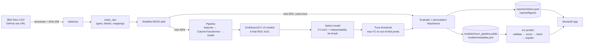

| Path | Purpose |
|---|---|
| `src/config.py` | Paths, dataset URL + checksum, column schema |
| `src/data_loader.py` | Download, verify, load raw CSV (all columns as text) |
| `src/preprocessing.py` | `clean_raw`, `validate_features` (prediction-time input checks), `build_preprocessor` |
| `src/features.py` | Engineered features as a pipeline step |
| `src/train.py` | Ablation, grid search, selection, threshold, evaluation, explainability, saving |
| `src/evaluate.py` | Metrics, threshold search, risk-band stats, plots |
| `src/predict.py` | `load_model`, `ChurnModel.predict`, `ChurnModel.explain`, CLI |
| `app/streamlit_app.py` | App entry point: theme, top navigation |
| `app/views/` | One file per page (overview, scorer, batch scoring, insights, drivers, model, recommendations) |
| `app/ui.py` | Shared helpers: cached loading, labels, Altair charts, batch scoring |
| `notebooks/churn_analysis.ipynb` | EDA narrative using the same cleaning code |
| `tests/` | 68 pytest tests (preprocessing, features, prediction, metrics, every app page, UI helpers) |

## Streamlit app

A multi-page app with top navigation (`app/streamlit_app.py`, pages in `app/views/`). It only loads
the saved pipeline and the training reports; it never retrains.

| Page | What it does |
|---|---|
| **Overview** | Headline numbers, what the app can do, and four key findings |
| **Score a customer** | Sliders, toggles and segmented controls instead of 19 dropdowns. The score updates live: churn probability, a LOW / MEDIUM / HIGH badge, a risk meter showing the band cut-offs, a suggested next step, and a "what drives this score" chart (exact log-odds contributions). Includes one-click example customers |
| **Score a list** | Upload a CSV (same columns as the dataset; `customerID` kept, blanks imputed). Every row is validated and scored, then shown ranked by risk with band counts and a CSV download |
| **Data insights** | Churn rate by any factor, against the overall average, with a generated one-line summary |
| **Churn drivers** | Permutation importance and signed logistic-regression coefficients, in plain language with the correlation caveats |
| **Model performance** | Model comparison, the threshold trade-off in customer counts, and interactive ROC, threshold-tuning, confusion-matrix and calibration charts |
| **Recommendations** | Five testable retention ideas, each with its supporting numbers and a caveat, plus a playbook per risk band |

Dependent inputs stay consistent: add-ons are cleared and locked when internet is "None", and
multiple lines are locked without phone service. Every number shown is read from
`models/metadata.json` or `reports/metrics.json`, so the app stays in sync with the latest training run.
The full-width dark theme (larger base font, colour-accented cards and page banners) lives in
`.streamlit/config.toml` and the CSS in `app/ui.py`. Chart colours are the dark-mode
steps of a colour-blind-checked palette, validated against the app background.

| Score a customer | Score a list |
|---|---|
|  | 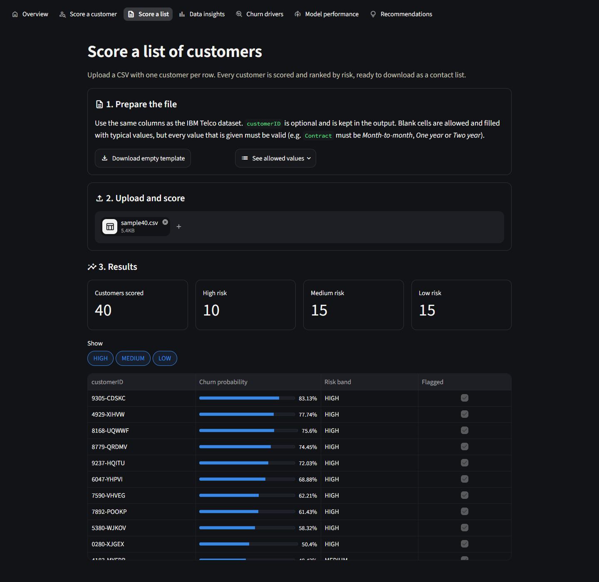 |

| Overview | Data insights |
|---|---|
| 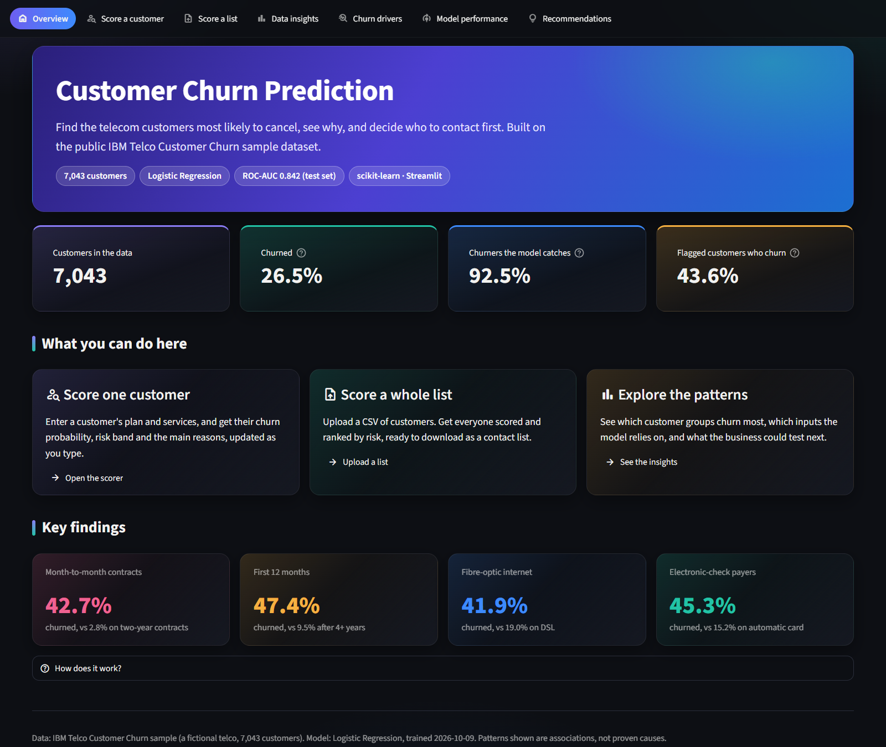 | 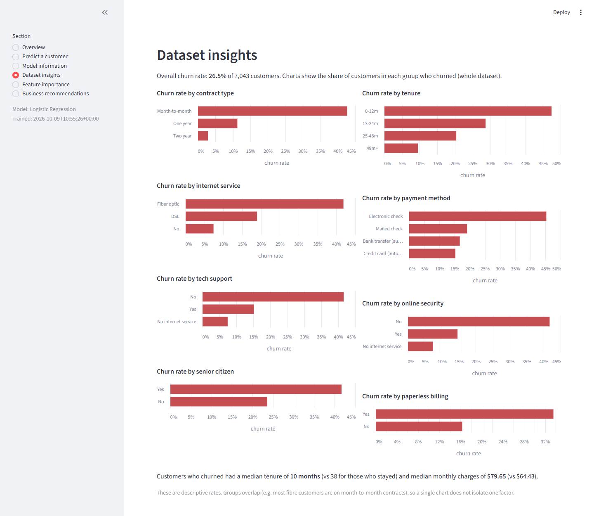 |

| Churn drivers | Model performance |
|---|---|
| 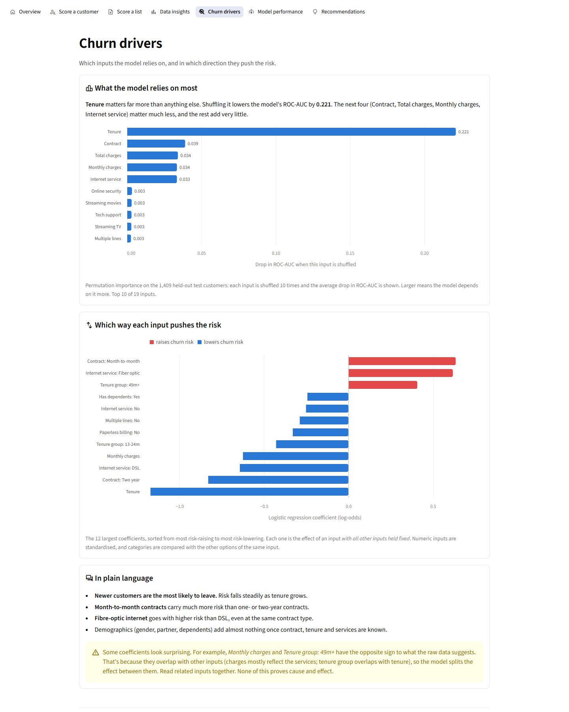 | 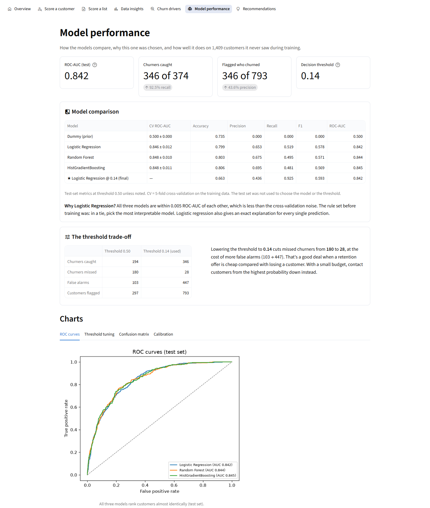 |

Screenshots were captured from the running app (headless Chrome). The list example uses the first
40 rows of the dataset.

## How to run

Requires Python 3.11 (tested on 3.11.9, Windows 11).

```bash
git clone https://github.com/Omkar210404/Customer-Churn-Prediction.git
cd Customer-Churn-Prediction
python -m venv .venv
# Windows: .venv\Scripts\activate    macOS/Linux: source .venv/bin/activate
pip install -r requirements.txt

python -m src.data_loader            # download + verify dataset (~1 MB)
python -m src.train                  # optional: retrain (~1-2 min on a laptop CPU), rewrites models/ and reports/
pytest                               # 68 tests
streamlit run app/streamlit_app.py   # http://localhost:8501
```

The trained pipeline (`models/churn_pipeline.joblib`, 3 KB) is committed, so the app and
`src.predict` work right after `pip install`, without retraining. `src.data_loader` is only needed
for training and the notebook.

## Example prediction

```bash
python -m src.predict --json '{"gender":"Female","SeniorCitizen":0,"Partner":"No","Dependents":"No","tenure":2,"PhoneService":"Yes","MultipleLines":"No","InternetService":"Fiber optic","OnlineSecurity":"No","OnlineBackup":"No","DeviceProtection":"No","TechSupport":"No","StreamingTV":"Yes","StreamingMovies":"Yes","Contract":"Month-to-month","PaperlessBilling":"Yes","PaymentMethod":"Electronic check","MonthlyCharges":95.5,"TotalCharges":190.0}'
```
```
Model: Logistic Regression  |  threshold 0.14  |  HIGH from 0.50
   churn_probability risk_band  flagged
0              0.798      HIGH     True
```

From Python:

```python
from src.predict import load_model
model = load_model()
model.predict(records)        # DataFrame: churn_probability, risk_band, flagged
model.explain(record)         # per-input contribution to the log-odds (logistic regression only)
```

Invalid input fails with a clear message, e.g. `Invalid value(s) for Contract: ['Weekly']. Allowed: [...]`.
Missing fields are imputed.

## Business insights

Patterns in this dataset, framed as hypotheses to **test** (e.g. with A/B tests), not proven causes:

1. **Month-to-month customers** churn at 42.7% vs 2.8% on two-year contracts. Incentives to move
   to annual contracts are the obvious experiment. Part of the gap is the contract's lock-in itself.
2. **The first year matters most**: 47.4% churn in months 0–12. Early onboarding and check-ins are
   cheap to trial.
3. **Fibre optic** customers churn at more than twice the DSL rate overall (41.9% vs 19.0%), and more
   within every contract type. The data cannot say whether price, quality or competition is behind it.
   That needs customer research.
4. **Electronic check** payers churn at 2.7–3× the rate of automatic-payment customers. Nudging
   towards automatic payment is worth testing.
5. **Add-ons**: internet customers without online security or tech support churn far more. A bundled
   trial may help, but committed customers may simply be the ones who buy add-ons.

**Operationally:** score customers regularly and contact HIGH, then MEDIUM, as the budget allows. At
the 0.14 threshold the model catches 92.5% of test-set churners, but only 43.6% of flagged
customers actually churn.

## Limitations

* **Fictional, single-snapshot data.** IBM's sample describes one quarter of a fictional company.
  Results show what this dataset contains, not how a real telco's customers behave.
* **No time dimension.** Churn is a label, not an event in time. The model cannot predict *when* a
  customer will leave, and a proper deployment would need a time-based train/test split.
* **Tenure is capped at 72 months** in the source (362 customers sit at the cap).
* **Associations, not causes.** Feature importance and coefficients describe the model, and correlated
  inputs share credit. Business actions need experiments.
* **Model differences are within noise.** The three models' ROC-AUCs differ by less than one CV
  standard deviation, so no model is meaningfully "better" on this data.
* **Threshold assumes cheap offers.** F2 encodes "a missed churner costs much more than a false alarm".
  The real cost ratio is unknown, so the threshold should be re-tuned with actual costs.
* **The app's Total charges default** is tenure × monthly charges, an approximation. Real billed
  totals can differ.
* **Tests use hand-written fixtures** for unit tests, plus smoke tests on the real saved model. They
  check behaviour, not model quality.

## Future improvements

* Cost-based threshold using real retention-offer cost and customer lifetime value.
* Probability calibration check on a larger real dataset, and monitoring for data drift.
* SHAP values for the tree models to compare explanations across models.
* Survival analysis (time-to-churn) if event timestamps were available.
* Deploy the app (e.g. Streamlit Community Cloud) with a live demo link.

## License

MIT, see [LICENSE](LICENSE). The dataset is IBM sample data under Apache-2.0 and is downloaded,
not redistributed.
